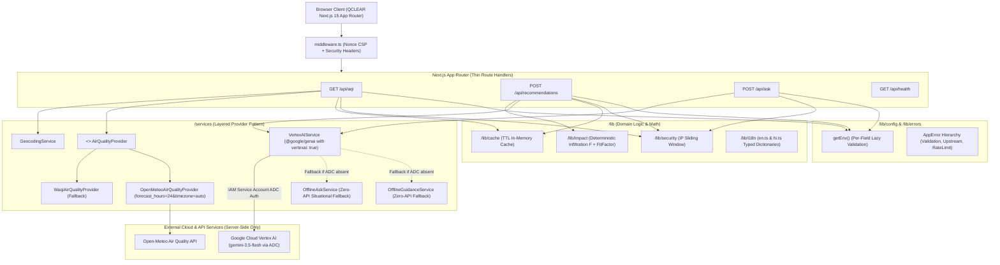

# QCLEAR (शुद्ध वायु साथी)
### Bilingual GenAI Urban Smog & Clean Air Living Companion

[](https://cloud.google.com/run)
[](https://www.w3.org/WAI/WCAG21/quickref/)
[](https://cloud.google.com/vertex-ai)

> **Challenge:** "Create a GenAI-powered assistant that helps families and communities navigate severe winter smog and urban air pollution. It should suggest low-emission daily routines, indoor air quality hacks, and sustainable alternatives tailored to their location and lifestyle, while clearly explaining the direct impact of their choices."
>
> Built for the **Virtual Prompt Wars Challenge**, evaluated on: **Problem Statement Alignment (Highest Priority)**, **Code Quality**, **Security**, **Efficiency**, **Testing**, and **Accessibility**.

---

## 1. Problem Statement Alignment

QCLEAR centers entirely on empowering families, schools, and urban community leaders to survive and mitigate severe winter smog:
1. **Live Atmospheric Air Quality Dashboard & Controls:** Zero-key real-time US AQI, PM2.5, PM10, NO2, O3, and CO powered by Open-Meteo with geocoding, 10-minute auto-refresh, GPS location, visible **"Last Updated"** timestamp, manual **"Refresh"** button with loading indicator and `aria-live="polite"` feedback, and clear data source attribution.
2. **Real 24-Hour Hourly Trend with Dynamic Window Derivation:**
   - **Recommended Ventilation Window:** Programmatically derived as the lowest 3-consecutive-hour PM2.5 period during waking hours (07:00 to 21:00 local time).
   - **Peak Smog Inversion Window:** Programmatically derived as the highest 3-consecutive-hour PM2.5 period across the entire 24-hour cycle.
3. **The Three Pillars of Action:**
   - *Pillar 1: Daily Routines:* Time-blocked hourly schedules for morning inversion defense, school transit, and window seal times.
   - *Pillar 2: IAQ Hacks:* Budget-tiered interventions (Tier 0 free damp mopping, Tier 1 Corsi-Rosenthal DIY box and draft sealing, Tier 2 HEPA placement).
   - *Pillar 3: Sustainable Alternatives:* Community-scale swaps (Rapid Metro transition, horticultural waste composting, electric room heating swaps).
4. **Three One-Click Demo Presets:**
   - 👨‍👩‍👦 **Family with Toddler & Elderly:** High vulnerability, gas cooking, daily school transit in Anand Vihar, New Delhi.
   - 🏫 **School & RWA Administrator:** Outdoor sports alerts, campus leaf-burning suppression, carpooling in Dwarka, New Delhi.
   - 💻 **Remote Worker with Purifier:** Home office draft sealing, motorized two-wheeler transit in South Delhi.
5. **Interactive Impact Simulator:**
   - Toggling habits dynamically updates personal indoor PM2.5 drops, cumulative weekly exposure reduction %, and collective community emissions avoided (kg CO2 / g PM2.5).
6. **Bilingual & Plain Language ("सरल भाषा") Modes:**
   - Header switcher (EN / हिन्दी) with typed dictionary key parity, Devanagari typography, and a "Simple Language" switch for plain, short sentences.
7. **Grounded "Ask QCLEAR" Assistant (`/api/ask`):**
   - Context-aware situational Q&A assistant grounded in live AQI/PM2.5/PM10 readings, selected household demographics, language (`en`/`hi`), and plain-language mode.
   - Quick-prompt suggestion pills (school assemblies, infant room ventilation, purifier placement).
   - Rate limited, 300-char max, injection-defended, with clear `[AI-Generated]` vs `[Curated Offline Guidance]` badging and non-medical disclaimer.

---

## 2. System Architecture



---

## 3. Security Architecture (Zero API Keys)

1. **Vertex AI Application Default Credentials (ADC):**
   - QCLEAR does **not** use, store, or require API keys.
   - Initialized using official `@google/genai` in Vertex AI mode (`{ vertexai: true, project: env.GOOGLE_CLOUD_PROJECT, location: env.GOOGLE_CLOUD_LOCATION }`).
   - On Google Cloud Run, identity is asserted by an attached IAM service account:
     `qclear-runner@$PROJECT_ID.iam.gserviceaccount.com` granted strictly `roles/aiplatform.user`.
   - In local development, simply run `gcloud auth application-default login`. If unauthenticated or `GOOGLE_CLOUD_PROJECT` is absent, QCLEAR automatically operates in **Curated Offline Guidance mode** without failing.
2. **Resilient Non-Throwing Configuration:**
   - Environment variables are validated on a per-field basis in `src/lib/config/config.ts`. If an individual variable fails, QCLEAR logs a warning and falls back only for that variable without discarding the entire environment.
3. **Content Security Policy with Cryptographic Nonce (`middleware.ts`):**
   - Enforces `connect-src 'self'` (all upstream provider requests happen strictly server-side).
   - Generates unique random base64 nonces per request for Next.js scripts.
   - Enforces `X-Content-Type-Options: nosniff`, `X-Frame-Options: DENY`, and `Referrer-Policy: strict-origin-when-cross-origin`.
4. **Prompt Injection & Input Hardening:**
   - All parameters are validated via strict Zod schemas (`aqiQuerySchema`, `recommendationRequestSchema`).
   - Model output is re-validated through `aiRecommendationsOutputSchema` before returning to the client.

---

## 4. Deterministic Impact Calculator: Assumptions & Sources

To eliminate generative hallucinations, **all quantitative impact metrics are computed deterministically** in `src/lib/impact/calculator.ts`.

### Mathematical Formulation
1. **Building Envelope Infiltration ($F = 0.55$):**
   - Fraction of ambient outdoor PM2.5 entering unsealed residential living spaces.
   - *Labelled explicitly as an `[Illustrative Assumption]` representing typical unsealed urban homes.*
2. **Indoor Ambient Exposure:**
   $$\text{Indoor Infiltration Term} = C_{\text{ambient}} \times F \times (1 - \eta_{\text{envelope}}) \times \prod_{k \in \text{air cleaners}} (1 - \eta_k)$$
   - Corsi-Rosenthal Box Efficiency $\eta_{cr} = 0.70$ (`[Illustrative Assumption]`).
   - Draft Sealing Foam Efficiency $\eta_d = 0.20$ (`[Illustrative Assumption]`).
3. **Indoor-Generated Source Reductions:**
   $$\text{Indoor Generated Remaining} = \max\left(0, 25.0\,\mu\text{g/m}^3 - \sum \Delta_{\text{source}}\right)$$
   - Damp mopping instead of dry brooming: $\Delta = 6.0\,\mu\text{g/m}^3$ prevented.
   - Kitchen exhaust timing during frying: $\Delta = 14.0\,\mu\text{g/m}^3$ prevented.
   - *Acts directly on internal generated particulates, separate from outdoor ambient infiltration.*
4. **Outdoor Commute Inhaled Dose Avoided:**
   $$\Delta \text{Dose Avoided} (\mu\text{g/day}) = C_{\text{ambient}} \times V_{\text{breathing}} \times \left(\frac{T_{\text{commute}}}{60}\right) \times (\eta_{\text{filter}} \times \text{FitFactor})$$
   - Respiration rate: $V = 0.8\,\text{m}^3/\text{hour}$ (US EPA Exposure Factors Handbook, 2011).
   - N95 media efficiency: $\eta = 0.95$ (NIOSH 42 CFR Part 84).
   - Consumer fit factor: $80\%$ (`[Illustrative Assumption]` accounting for edge leakage).
   - *Explicit rule: Wearing a mask does NOT reduce indoor PM2.5.*

### Citations Registry
* **CPCB NAAQS Standard (2009):** Central Pollution Control Board 24-hr PM2.5 safe threshold ($60\,\mu\text{g/m}^3$). [cpcb.nic.in](https://cpcb.nic.in/air-pollution/)
* **US EPA Air Cleaners in the Home (2018):** General reference on portable air cleaner mechanisms and MERV ratings. [epa.gov](https://www.epa.gov/indoor-air-quality-iaq/air-cleaners-and-air-filters-home)
* **US EPA Exposure Factors Handbook (2011):** Chapter 6: Inhalation Rates ($0.8\,\text{m}^3/\text{hr}$ light exertion). [epa.gov](https://www.epa.gov/expobox/about-exposure-factors-handbook)

---

## 5. Local Development Setup

### Prerequisites
- Node.js 22+ (LTS)
- npm 10+

### Installation & Run
```bash
# 1. Install dependencies
npm install

# 2. Run local development server
npm run dev

# 3. Open in browser
# http://localhost:3000
```
*Note: QCLEAR starts immediately in **Curated Offline Guidance mode** without requiring any GCP credentials.*

### Optional: Enable Live Vertex AI Locally
```bash
# Authenticate with your Google Cloud project credentials
gcloud auth application-default login

# Set your project in .env.local
echo "GOOGLE_CLOUD_PROJECT=your-gcp-project-id" >> .env.local
echo "GOOGLE_CLOUD_LOCATION=global" >> .env.local
echo "GEMINI_MODEL=gemini-3.5-flash" >> .env.local

npm run dev
```

---

## 6. Testing & Quality Verification

Run the complete test suite:
```bash
# Run all unit, integration, and accessibility tests (33 tests across 10 files)
npm test

# Run TypeScript strict typecheck
npm run typecheck

# Run Next.js production linter
npm run lint

# Run standalone Next.js production build
npm run build

# Run real headless Chromium verification suite (12/12 checks: CSP, hydration, contrast)
npm run verify:browser

# Audit Vertex AI & Application Default Credentials (ADC) status
npm run verify:vertex
```

### Test Suite Breakdown (33 Tests, 10 Test Files, 0 Failures)
* **Unit Tests (`src/tests/unit/`):**
  - `windowDerivation.test.ts`: Verifies dynamic 3-hour sliding windows for waking ventilation (07:00–21:00) vs. 24h peak smog.
  - `impactCalculator.test.ts`: Verifies bounds, infiltration factor $F=0.55$, indoor source terms, and mask isolation.
  - `simulatorInteraction.test.ts`: Verifies additive habit toggling and exposure reductions.
  - `clientIp.test.ts`: Verifies `getClientIp` IP extraction from `x-forwarded-for` and fallback chains.
  - `i18nParity.test.ts`: Asserts 100% key and structure parity between `en.ts` and `hi.ts`.
  - `config.test.ts`: Verifies lazy non-throwing validation and per-field fallback.
* **Route Integration Tests (`src/tests/integration/`):**
  - `aqiRoute.test.ts`: Tests `GET /api/aqi` with geocoding, Open-Meteo, caching, and rate limiting.
  - `recommendationsRoute.test.ts`: Tests `POST /api/recommendations` with prompt generation, schema validation, and offline fallback.
  - `askRoute.test.ts`: Tests `POST /api/ask` with 300-char limits, injection defense, language modes, and fallback.
* **Accessibility Tests (`src/tests/a11y/`):**
  - `dashboardA11y.test.tsx`: Automated WCAG 2.1 AA audit with `jest-axe`, keyboard navigation, and ARIA attributes.

---

## 7. Google Cloud Run Deployment

QCLEAR is containerized with a multi-stage Docker build producing a standalone Node.js server running as non-root user `nextjs` on port `8080`.

### Automated Deployment
```bash
# Make the deployment script executable
chmod +x scripts/deploy.sh

# Deploy to Cloud Run (scales 0 to 3, region: asia-south1, vertex: global)
./scripts/deploy.sh
```

### Manual Deployment Command
```bash
PROJECT_ID="your-gcp-project-id"

gcloud run deploy qclear \
  --source . \
  --platform managed \
  --region asia-south1 \
  --service-account "qclear-runner@${PROJECT_ID}.iam.gserviceaccount.com" \
  --allow-unauthenticated \
  --min-instances 0 \
  --max-instances 3 \
  --set-env-vars="GOOGLE_CLOUD_PROJECT=${PROJECT_ID},GOOGLE_CLOUD_LOCATION=global,GEMINI_MODEL=gemini-3.5-flash"
```

---

## 8. Known Limitations & Architecture Notes
* **In-Memory Cache Coherence:** The in-memory TTL cache (10m for AQI, 60m for AI) is local to each Cloud Run instance. If scaled beyond `--max-instances 3`, a distributed Redis cache (such as Google Cloud Memorystore) should be introduced for centralized cache coordination.
* **Open-Meteo Modelled Estimates:** Values are atmospheric dispersion models rather than raw physical station hardware sensors. This ensures complete geographic coverage across all urban and rural coordinates without API key requirements.
